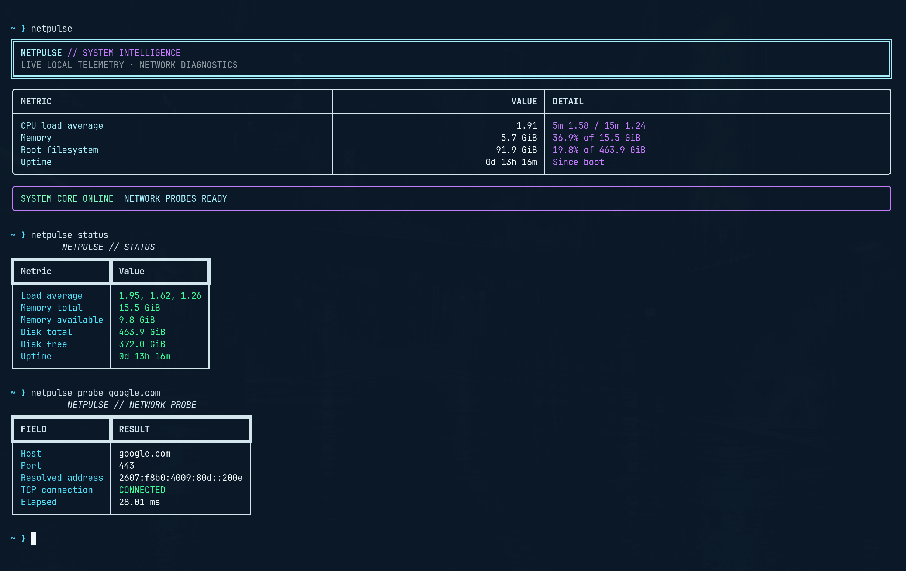

# NetPulse

NetPulse is a Linux system monitoring and network diagnostics CLI
built with C++20, Go, and Python.

## Features

- Linux load averages, memory, filesystem capacity, and uptime
- DNS resolution and TCP connectivity diagnostics
- Rich terminal dashboard
- JSON communication between language components
- Single Bash installer and global launcher
- Python unit tests and Go validation

## Screenshot

## Requirements

- Linux
- C++ compiler supporting C++20
- CMake 3.20+
- Go 1.23+
- Python 3 with venv and pip support

## Installation

From the project directory:

    ./scripts/netpulse --install

If ~/.local/bin is not in PATH, add this line to ~/.bashrc:

    export PATH="$HOME/.local/bin:$PATH"

Reload your shell:

    source ~/.bashrc

Run NetPulse from any directory:

    netpulse

## Commands

    netpulse
    netpulse dashboard
    netpulse status
    netpulse probe example.com
    netpulse probe example.com --port 443
    netpulse probe example.com --port 443 --timeout 5

## Build

    netpulse --build

## Tests

    cd ~/GitHub_Cli_Projects/netpulse

    .venv/bin/python -m unittest discover -s tests -v

    cd go
    go test ./...
    go vet ./...

    cd ../..
    cmake -S cpp -B build/cpp -DCMAKE_BUILD_TYPE=Release
    cmake --build build/cpp --parallel

## Uninstall the global command

    netpulse --uninstall

The project files and build artifacts remain on disk after uninstalling.

## Architecture

- C++20 reads local Linux system metrics and returns JSON.
- Go performs DNS and TCP connectivity checks.
- Python provides the command interface and terminal dashboard.
- Bash installs the project-named command and launches the application.

NetPulse is a diagnostic utility, not a security guarantee or
a replacement for a firewall, endpoint protection, or monitoring service.
